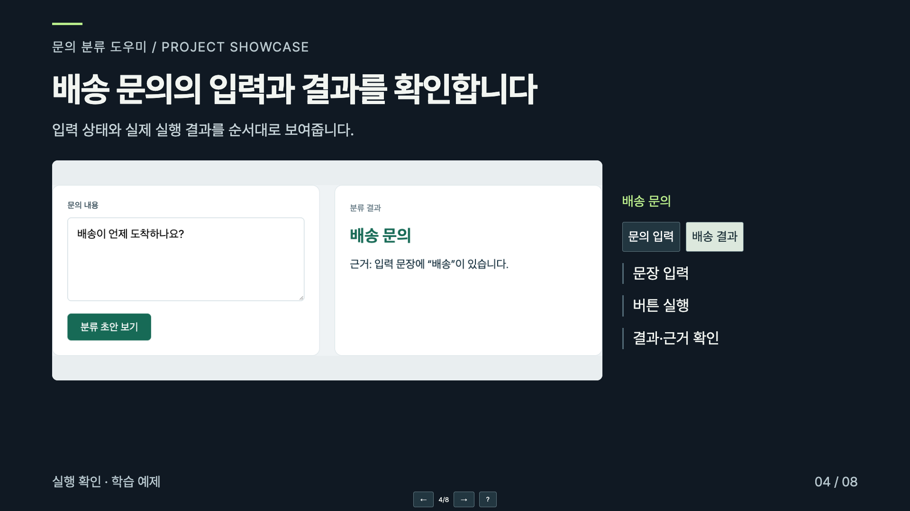

# Project Showcase

**만든 프로젝트를 읽고, 바로 소개할 수 있는 슬라이드와 영상으로.**

Turn a built project into an evidence-based HTML presentation and a narrated demo video.

바이브코딩으로 만든 웹앱, 개발 도구, 자동화 스크립트, 프로토타입의 구조·기능·실행 결과를 분석하는 Claude Code / Codex 스킬입니다. 제품 데모, 포트폴리오, 팀 공유, 해커톤 발표에 사용할 수 있습니다.



## 만드는 결과물

- 키보드 탐색과 데모 화면 선택을 지원하는 **HTML 슬라이드 8장**
- 한국어 내레이션·자막이 포함된 **약 3분 MP4** — 기본 1920×1080, 30fps
- 스펙, 스토리보드, 확정 대본, 5분 발표자 노트
- 실제 발화에 맞춘 화면 교체·확대·강조와 검수 기록
- 파일 해시와 검수 상태를 담은 제출 ZIP

실행한 기능, 코드만 확인한 기능, 미검증 내용을 구분합니다. 실행 화면을 확보하지 못하면 그 이유를 표시합니다. HTML 이미지 검사와 최종 MP4 청취를 별도 단계로 관리합니다.

## 빠른 시작

먼저 **Node 22+, Python 3.12 권장(최소 3.10), FFmpeg/ffprobe, Google Chrome**을 설치하세요. 온라인 음성 합성에는 인터넷이 필요합니다.

```sh
git clone https://github.com/Maximus2580/project-showcase.git
cd project-showcase
python3 scripts/install_global.py
```

Windows PowerShell에서는 마지막 명령을 `py -3.12 scripts/install_global.py`로 실행합니다. 기존 설치는 자동 덮어쓰기하지 않으며, `--replace`를 지정하면 백업 후 교체합니다. Windows 전체 제작 과정은 아직 실기기로 검증하지 않았습니다.

설치 후 작업할 프로젝트를 열어 Claude Code에서 `/project-showcase`를 실행하거나, Codex에 다음과 같이 요청하세요.

> project-showcase 스킬로 현재 프로젝트를 분석해 줘. 실제 기능과 실행 결과를 근거로 5분 발표용 HTML 8장과 약 3분 한국어 소개 영상을 만들어 줘. 구현한 내용과 미검증 내용을 구분하고, 마지막에는 내가 영상을 듣고 확인할 수 있게 해 줘.

환경만 먼저 확인하려면:

```sh
project-showcase --out showcase-output/preflight preflight
```

명령을 찾지 못하면 설치 프로그램이 출력한 전체 실행 경로를 사용하거나 `~/.local/bin`을 PATH에 추가하세요. 전역 설치 대신 프로젝트 폴더에 설치하려면 [설치 안내](.claude/skills/project-showcase/references/setup.md)를 따르세요.

## 제작 흐름

프로젝트 분석 → 스펙·스토리보드 → 정지 화면 디자인 → 대본 확정 → 음성 합성·실측 → 발화별 화면 연결 → 자동 검사 → 실제 프레임 검토 → 렌더 → 전체 청취 → ZIP 내보내기.

정상 음성은 재사용하고 실패 단계부터 재개합니다. 수동으로 수정한 HTML은 보호하며, 재생성을 선택하면 백업합니다. 원본 캡처나 대본이 바뀌면 이전 검사·리뷰·렌더를 그대로 제출할 수 없습니다.

## 예제와 문서

- [스킬 본문](.claude/skills/project-showcase/SKILL.md) · [데이터 계약](.claude/skills/project-showcase/references/data-contract.md)
- [사용 안내](docs/STUDENT-START.md) · [전역 설치](docs/GLOBAL-INSTALL.md) · [검수·복구](.claude/skills/project-showcase/references/quality.md)
- [브라우저 앱·CSV 자동화·실행 불가 예제](.claude/skills/project-showcase/examples/README.md)
- [검증 기록](docs/VALIDATION-V2.md) · [시각 리뷰](docs/REVIEW-V2.md) · [수업 운영 체크리스트](docs/INSTRUCTOR-CHECKLIST.md)

예제는 합성 데이터의 작은 규칙 기반 앱입니다. LLM 제품이나 실제 업무 성과를 시연한 것이 아닙니다. `init`로 생성한 sample은 본인의 프로젝트 근거로 바꿔 사용하세요.

## 검증과 제한

macOS에서 자동 검사, 실제 한국어 TTS, 렌더와 프레임 검토를 수행했습니다. 전체 음성 청취, Windows 실기기, 실제 사용자의 30분 완주는 별도 검증 대상입니다. 30분은 사전 설치와 프로젝트 실행 준비가 완료된 환경의 목표입니다. 온라인 TTS에는 개인정보·비밀정보를 제거한 대본만 사용하세요.

개발 테스트:

```sh
python3 -m venv .showcase-venv
.showcase-venv/bin/python -m pip install -r .claude/skills/project-showcase/requirements.txt
npm ci --prefix .claude/skills/project-showcase
.showcase-venv/bin/python -m unittest discover -s tests -q
```

## 라이선스

직접 작성한 코드와 문서는 [MIT](LICENSE)입니다. 동봉 폰트는 [Pretendard SIL Open Font License](.claude/skills/project-showcase/assets/fonts/LICENSE-Pretendard.txt)를 따릅니다. 설치 의존성과 참고 자료는 [출처·고지](.claude/skills/project-showcase/references/sources.md)를 확인하세요.
