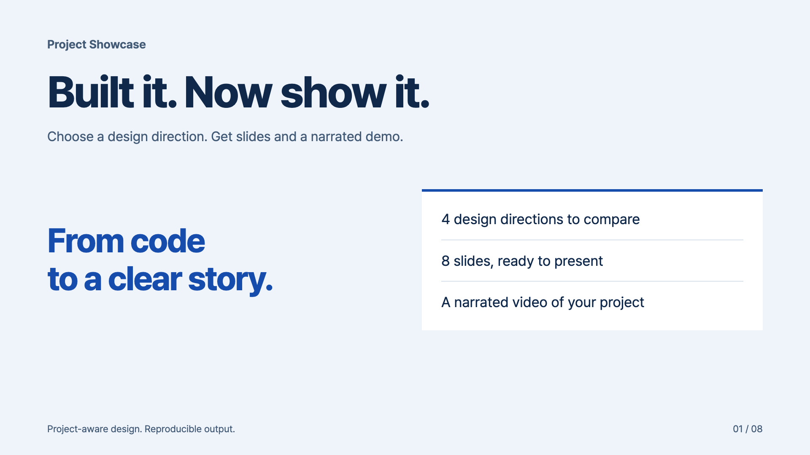

# Project Showcase

**완성한 프로젝트를 발표자료와 소개 영상으로 만드세요.**

[English](../README.md) · 한국어

Claude Code와 Codex에서 사용하는 스킬입니다. 프로젝트와 실제 실행 결과를 분석하고, 네 가지 디자인 방향을 비교한 뒤 발표자료를 만듭니다.



## 사전 준비

**Claude Code 또는 Codex**, **Python 3.12**, **Node.js 22 이상**, **Git**, **FFmpeg**, **Google Chrome**이 필요합니다. 설치와 한국어 음성 생성에는 인터넷을 사용합니다.

처음 설치한다면 [macOS·Windows 사전 준비 가이드](../docs/installation.ko.md)부터 따라 하세요. 어떤 도구를 설치하는지, 명령을 어디에 입력하는지, 정상 설치를 어떻게 확인하는지 안내합니다.

## 설치

macOS에서는 터미널, Windows에서는 PowerShell을 열고 실행하세요.

```sh
git clone https://github.com/Maximus2580/project-showcase.git
cd project-showcase
```

**macOS**

```sh
python3.12 scripts/install_global.py
```

**Windows**

```powershell
py -3.12 scripts/install_global.py
```

설치 프로그램이 전용 Python 환경과 필요한 패키지를 준비하고, Claude Code와 Codex에서 사용할 스킬을 설치합니다. 기존 프로젝트의 개발 환경과 분리됩니다. 설치 후 에이전트의 새 세션을 여세요.

## 사용하기

소개할 프로젝트를 엽니다. Claude Code에서는 `/project-showcase`를 실행하세요. Codex에서는 다음과 같이 요청하세요.

```text
project-showcase로 이 프로젝트를 소개해 줘.
코드와 실제 실행 결과를 분석하고, 네 가지 디자인 방향을 보여 줘.
각 방향마다 표지, 실제 데모, 정보가 많은 슬라이드를 한 장씩 만들어 줘.
내 선택을 기다린 뒤 HTML 발표자료 8장과
약 3분 분량의 한국어 내레이션·자막 영상을 만들어 줘.
```

1. **시안 확인:** 에이전트가 제공한 비교 HTML을 엽니다.
2. **선택 또는 수정:** “B안 r002로 해 줘. 데모 화면은 크게 유지하고 배경은 밝게 바꿔 줘.”처럼 말합니다.
3. **발표자료 검토:** 선택한 방향으로 전체 슬라이드·대본·영상을 만듭니다.
4. **재생 후 전달:** 영상을 처음부터 끝까지 보고 들은 뒤, 수정할 내용을 알려 주거나 제출 ZIP을 요청합니다.

디자인 수정을 요청하면 새 리비전을 보여 줍니다. 수정한 시안을 선택한 뒤 제작을 이어갑니다.

원하는 스타일이 있다면 첫 요청에 청중, 브랜드 색상, 참고 자료를 함께 주세요. 고정된 테마를 반복하는 방식이 아닙니다. 에이전트가 디자인을 작성하고, 도구가 실제 화면을 생성·검사합니다.

## 결과물

결과는 `showcase-output/<프로젝트>/`에 저장됩니다.

| 파일 | 용도 |
| --- | --- |
| `design/index.html` | 네 방향과 각 대표 슬라이드 세 장 비교 |
| `deck/index.html` | 8장 발표자료. 방향키로 이동, **F**로 전체 화면 |
| `renders/*.mp4` | 내레이션·자막 소개 영상 |
| `SCRIPT.md` · `SPEAKER-NOTES.md` | 영상 대본과 발표자 노트 |
| `exports/*.zip` | 검수 상태를 포함한 전달용 묶음 |

영상 기본값은 **1920 × 1080, 30fps, 한국어 음성**입니다. 실제 음성 길이에 맞춰 화면을 연결합니다. 확인하지 못한 기능과 확보하지 못한 화면은 구분해서 표시합니다.

## 업데이트·이어서 작업하기

처음 내려받은 저장소 폴더에서 실행하세요.

```sh
git pull
python3.12 scripts/install_global.py --replace
```

Windows에서는 `python3.12` 대신 `py -3.12`를 사용합니다. 기존 설치는 백업 후 교체합니다.

제작을 이어갈 때는 에이전트에게 요청하세요.

```text
showcase-output/my-project의 project-showcase 작업을 이어서 해 줘.
내가 수정한 파일은 보존하고, 바뀌지 않은 음성은 재사용해 줘.
남은 검수도 알려 줘.
```

## 도움이 필요할 때

- [사전 준비·환경 검사·자주 막히는 부분](../docs/installation.ko.md)
- [디자인 선택·수정·리비전 명령](../skills/project-showcase/references/design.md)
- [개발과 테스트](../docs/development.md)

macOS에서 검증했습니다. Windows 설치 안내는 제공하지만 전체 제작 과정의 실기기 검증은 남아 있습니다. 최종 영상 청취는 별도 단계이며 자동 검사로 완료 처리하지 않습니다.

[MIT 라이선스](../LICENSE). 포함된 Pretendard 폰트는 [SIL Open Font License](../skills/project-showcase/assets/fonts/LICENSE-Pretendard.txt)를 따릅니다.
